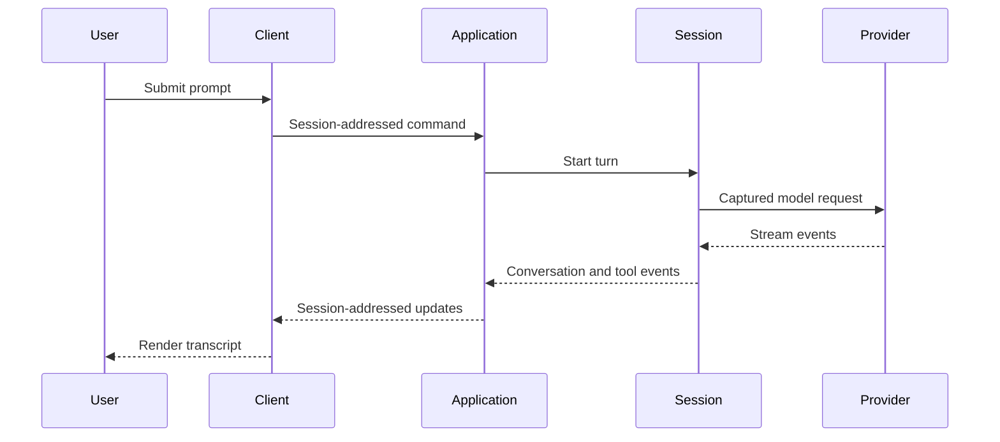

# Architecture

rpi separates model transport, agent execution, coding-session state, user interfaces, and platform confinement. Terminal, JSONL control, Web, and Agent Client Protocol adapters share the coding application rather than implementing independent tool runtimes.

## Crates

| Crate | Responsibility |
| --- | --- |
| `pi-ai` | Models, provider credentials at request boundaries, messages, streaming, provider transport |
| `pi-agent` | Agent turns, tool calls, events, approval integration, message queues |
| `pi-coding` | Application/session lifecycle, storage, tools, resources, trust, orchestration, workflows, imports/export |
| `pi-cli` | Argument parsing, terminal interface, panels, command adapters, listeners, browser client |
| `pi-sandbox` | Policy types, platform facts, authorized process preparation, confinement backends |

```text
Terminal / JSONL / Web / editor
              |
           pi-cli
              |
          pi-coding -------- pi-sandbox
              |
           pi-agent
              |
            pi-ai
```

## Session execution

The application owns session-level commands and state transitions. A session owns conversation execution and persisted journal state. A selected model is identified by provider and model identifier; the active turn captures that pair before streaming.

The Web runtime manager locates independently loaded session runtimes. Changing the displayed session changes the view target, not the identity of already-running work. Events must preserve session routing identity across multiplexed transport.



## Resource publication

One application generation groups resources, tools, extensions, orchestration, runtime settings, and security. Components share a revision and provenance. Candidate construction rejects mismatches; reload advances from the captured base instead of separately replacing unrelated pieces.

Filesystem capability leases retain authority independently of display paths. Governed process and HTTP operations consume the relevant generation. `danger-full-access` selects raw host execution; confined modes require a supported backend and retained roots.

## Work and persistence

- Child `task` jobs run coding sessions and communicate through `hub`; child-only `yield` delivers final text.
- The process manager owns operating-system processes, state, bounded logs, and termination escalation.
- The loop scheduler owns recurring prompts and timers and invokes the application runtime, not a nested shell CLI.
- Workflows own concurrent objectives, supervisors, and worktree/integration state.
- Todo snapshots persist task graphs and executor lifecycle in the session journal.
- Local memory is repository-scoped across sessions; it is not the session transcript.

Native storage uses Pi v3 JSONL. Import uses agent-loader v0.7.0 for Pi, OMP, Codex, Claude, Grok, and Droid conversion. OMP lineage and deduplication remain explicit import concerns. HTML export renders chronological records; JSONL export selects the current branch.

## Rendering boundaries

Web Markdown escapes input before formatting. Mermaid uses strict security and sanitized SVG. The file explorer's HTML preview is a separate empty-sandbox iframe; SVG preview uses an image element. These display boundaries do not provide host process confinement.

## In-progress area

The Web steering queue component is implemented, while Rust queue and scoped cancellation integration remain in progress. This architecture does not claim stable queued-prompt recovery or scoped cancellation semantics until the shared runtime contract is complete.
